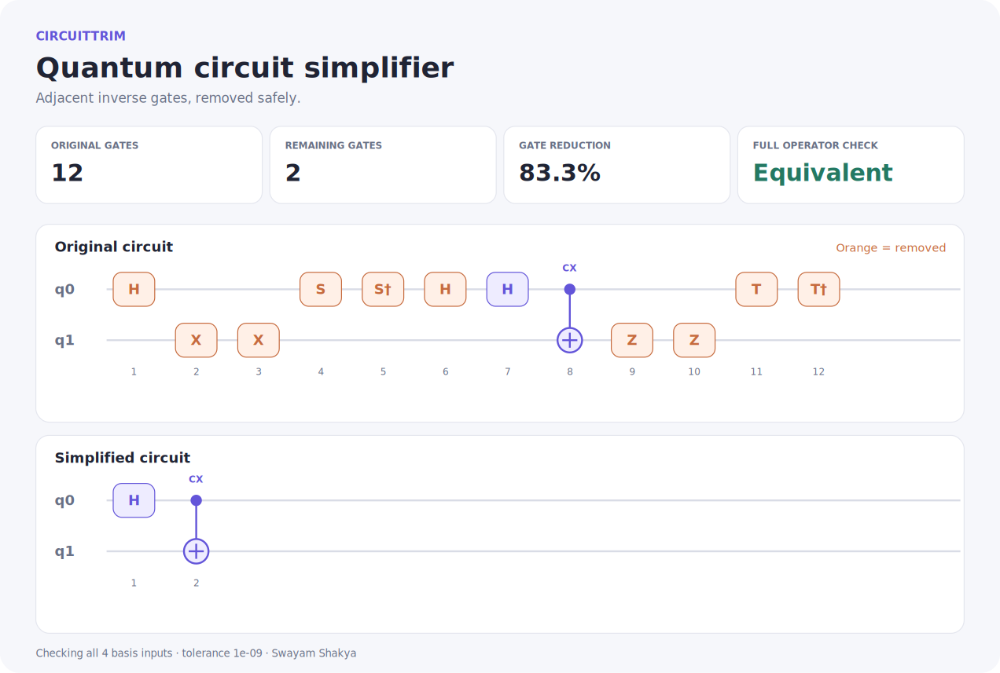
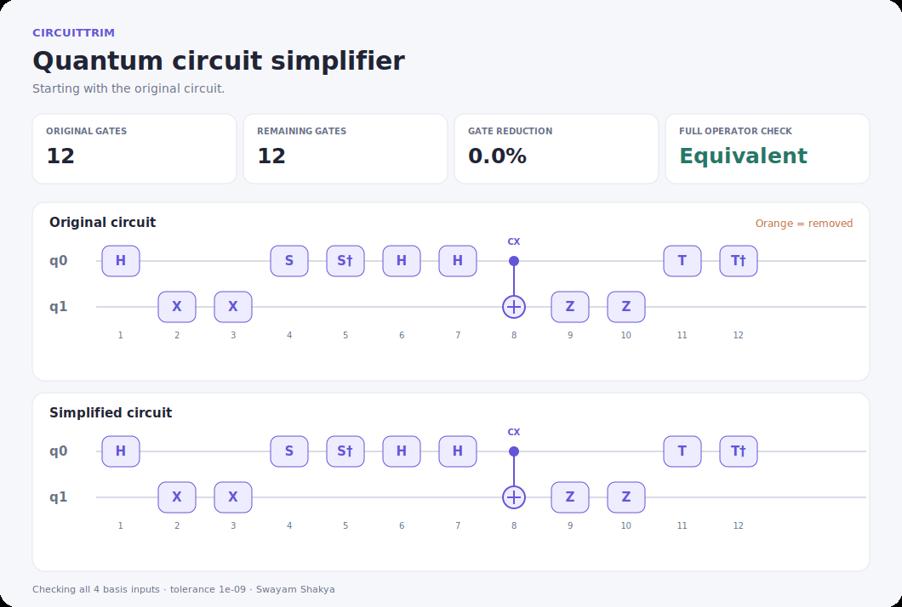

# CircuitTrim

**Simplify small quantum circuits. Check that their operations stay the same.**

By **Swayam Shakya** · Python 3.10+ · MIT License

CircuitTrim removes adjacent inverse gates, draws the before-and-after circuits, and verifies the complete circuit operation. It is a compact quantum computing project with a command-line tool and an interactive Jupyter notebook.

The core uses only Python's standard library. No dataset, API key, cloud account, or quantum hardware is required.



## Demo



This animation is rendered from actual simplifier results, one cancellation at a time. The Bell-state example goes from **12 gates to 2**, an **83.3% reduction**, while preserving its operation on all four basis inputs.

- **Interactive demo:** [notebooks/CircuitTrim.ipynb](notebooks/CircuitTrim.ipynb). Run it locally to use the controls; GitHub displays the static notebook preview.
- **Saved report:** [docs/demo.html](docs/demo.html). Download the project and open this file in a browser. It is a self-contained report, not a hosted application.
- **Vector diagram:** [docs/images/comparison.svg](docs/images/comparison.svg).

## Quick start

1. Install Python 3.10 or newer.
2. Extract the ZIP and open a terminal in the folder containing this README.
3. Run the example:

```bash
python -m circuittrim examples/bell.ct --qubits 2
```

On macOS or Linux, use `python3` if `python` is unavailable. On Windows, `py` may be used instead. The core command works directly from the extracted folder without installing anything else.

Expected summary:

```text
CircuitTrim 1.0.0 | 2 qubit(s)
Gates: 12 -> 2 (83.3% removed)
Equivalent: True | inputs checked: 4 | max error: ...

Simplified circuit:
H 0
CX 0 1
```

The final floating-point error can vary slightly by platform. It must be below the reported tolerance, `1e-9`.

### Open the interactive notebook

From the project folder:

```bash
python -m pip install -e ".[notebook]"
python -m jupyterlab
```

Open `notebooks/CircuitTrim.ipynb`, select a Python kernel from the same environment, and run the cells from the top. The workbench includes:

- Four example circuits and an editable instruction box.
- A qubit count selector and **Simplify & verify** button.
- Before-and-after diagrams, gate counts, and a cancellation log.
- Full-operation verification and calculated measurement probabilities.
- A downloadable HTML report.

Editing the circuit clears the previous result until it is recomputed. Invalid instructions produce an explanatory message rather than leaving an old result on screen.

See [SETUP.md](docs/SETUP.md) for virtual environments and Jupyter troubleshooting. The notebook dependencies need an internet connection to install; the application runs locally afterward.

## Write a circuit

Use one gate per line, or separate instructions with semicolons:

```text
H 0
X 1
X 1
CX 0 1
```

This becomes:

```text
H 0
CX 0 1
```

Gate names are case-insensitive. `H q0` and `CX q0, q1` also work. `#` starts a comment. An empty circuit means the identity operation.

| Gate | Arguments | Cancels with |
|---|---|---|
| H, X, Y, Z | One qubit | The same gate on the same qubit |
| S | One qubit | SDG |
| SDG | One qubit | S |
| T | One qubit | TDG |
| TDG | One qubit | T |
| CX | Control, target | CX with the same control and target |
| CZ | Two different qubits | CZ on the same pair |
| SWAP | Two different qubits | SWAP on the same pair |

CZ and SWAP are symmetric, so reversing their listed wires does not change the gate. Reversing CX changes its control direction and is not treated as the same gate.

**Bit order:** q0 is the least significant bit. `X 0` on a three-qubit all-zero state produces `001`. Diagrams show q0 at the top; probability labels read q(n−1)…q0.

## Command-line examples

```bash
# Running a cascading cancellation
python -m circuittrim --text "H 0; X 0; X 0; H 0" --qubits 1

# Saving diagrams and reports
python -m circuittrim examples/bell.ct --qubits 2 --report reports/bell.html --svg reports/bell.svg --json reports/bell.json

# Trying a three-qubit example
python -m circuittrim examples/three_qubits.ct --qubits 3

# Showing available options
python -m circuittrim --help
```

Output folders are created when needed. Existing output files are replaced, but an output cannot overwrite the input circuit file. Every output format needs its own path. Exit codes are `0` for verified success, `1` for a failed equivalence check, and `2` for invalid input or a file error.

You can also install the command with `python -m pip install .`, then use `circuittrim` instead of `python -m circuittrim`.

## Python API

```python
from circuittrim import parse_circuit, simplify, verify

original = parse_circuit("H 0; X 0; X 0; H 0", n_qubits=1)
result = simplify(original)
check = verify(original, result.simplified)

print(result.removed)                 # 4
print(result.simplified.to_text())     # Empty: the identity circuit
print(check.equivalent)               # True
```

`evolve(circuit, state)` accepts a normalized complex state vector. `statevector(circuit, basis=0)` starts from a computational basis input. `probabilities(circuit)` returns calculated probabilities from the all-zero input by default.

## Why verification matters

A probability chart alone does not prove two circuits are equivalent. For example, applying Z to `|0⟩` and doing nothing produce the same measurement probabilities, but the operations differ on other inputs.

CircuitTrim compares complex output amplitudes for **every computational basis input**. These outputs form the columns of the operator, so checking them checks its action on any input superposition. The comparison uses a tolerance of `1e-9` and includes phase. It is deliberately stricter than equivalence up to a global phase.

The simplifier itself is a stack-based pass: each gate is pushed once and popped at most once. See [ALGORITHM.md](docs/ALGORITHM.md) for a worked example and the exact scope.

## Tests

From the project folder:

```bash
python -m unittest discover -s tests -v
```

The core and export tests need no extra dependencies. Installing the notebook extra also enables the five widget tests. The suite includes:

- Known gate matrices, Bell and GHZ states, and control/target direction.
- All supported inverse pairs on every valid wire combination for 1–4 qubits.
- An independent reference calculation for individual gate operations.
- **500 seeded randomized circuits**, checking equivalence and idempotence.
- Parsing errors, empty circuits, size limits, phase differences, exports, and paths containing spaces.
- Notebook controls, invalid input recovery, and stale-result handling.

For the notebook execution check:

```bash
python -m pip install -e ".[notebook,dev]"
python scripts/check_notebook.py
```

A GitHub Actions workflow is included for Windows, macOS, and Linux on Python 3.10, 3.12, and 3.13. Those jobs run after you upload the repository; their inclusion does not mean they have already run. Actual local results and their limits are recorded in [TESTING.md](docs/TESTING.md).

## Project files

| Path | Purpose |
|---|---|
| `circuittrim/core.py` | Circuit model, parser, simplifier, simulator, and verifier |
| `circuittrim/render.py` | SVG, HTML, and JSON exports |
| `circuittrim/workbench.py` | Interactive notebook controls |
| `circuittrim/cli.py` | Command-line interface |
| `notebooks/CircuitTrim.ipynb` | Runnable walkthrough and interactive demo |
| `examples/` | Four editable circuit files |
| `tests/` | Core, export, command-line, and widget tests |
| `docs/images/` | Included diagrams and animated walkthrough |
| `scripts/` | Notebook validation and reproducible demo generation |
| `.github/workflows/tests.yml` | Cross-platform checks for GitHub Actions |

## Scope

- Supporting **1–4 qubits** and **up to 120 gates** keeps full verification quick.
- Only adjacent inverse pairs are removed, including pairs exposed by earlier removals. Gates are not commuted or rearranged.
- `S; S` is not rewritten as Z, and arbitrary rotation angles are not supported.
- This version does not include measurement instructions, reset, classical conditions, noise, or hardware execution.
- Gate count reduction is not a measurement of hardware speed or fidelity.
- The result is not guaranteed to be the globally smallest circuit.

## Rebuild the demo images

The original SVG, PNG, and GIF assets are included. To regenerate them:

```bash
python -m pip install -e ".[dev]"
python scripts/make_demo.py
```

CairoSVG may need the Cairo system library, particularly on Windows. This dependency is only for rebuilding PNG/GIF assets; normal use, SVG export, and the notebook do not require it.

## Upload to GitHub

Create an empty repository named `circuittrim` (or your preferred name). Upload the **contents of the extracted project folder**, including `README.md`, `LICENSE`, and `.github/`. Do not upload just the ZIP. Alternatively, initialize Git locally and push to your own repository URL.

The relative image links and notebook preview will work after upload. No account-specific URLs are hardcoded.

## References

- [IBM Quantum: inverse cancellation](https://eu-de.quantum.cloud.ibm.com/docs/en/api/qiskit/qiskit.transpiler.passes.InverseCancellation)
- [IBM Quantum: Hadamard gate](https://quantum.cloud.ibm.com/docs/en/api/qiskit/1.1/qiskit.circuit.library.HGate)
- [Python: unittest](https://docs.python.org/3/library/unittest.html)

These references describe the underlying concepts and test tooling. CircuitTrim implements its own small simulator and does not require Qiskit.

## License

MIT License. Copyright © 2026 **Swayam Shakya**. See [LICENSE](LICENSE).
